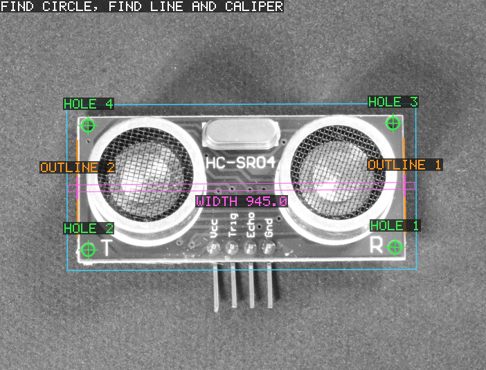
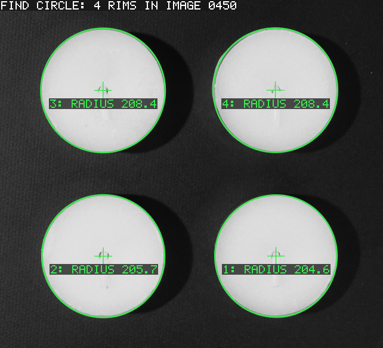
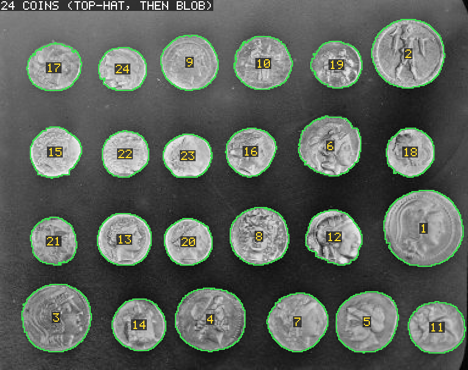
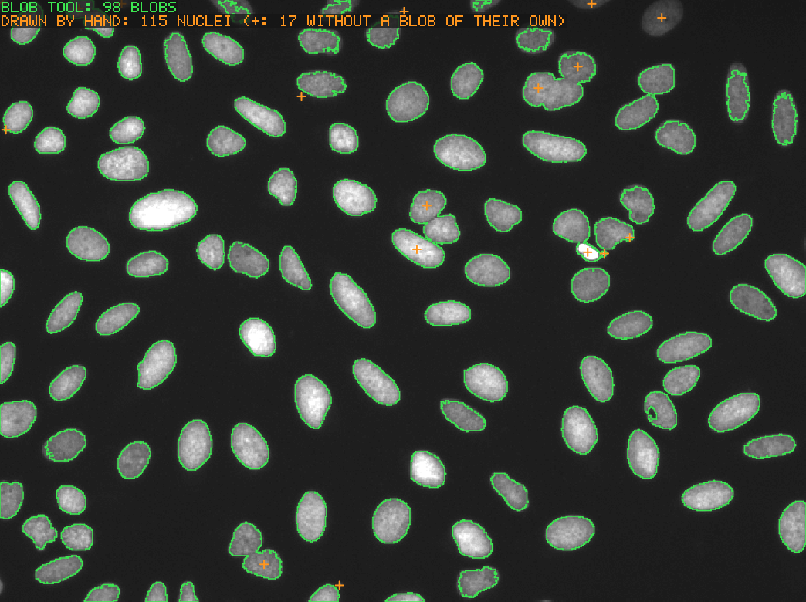
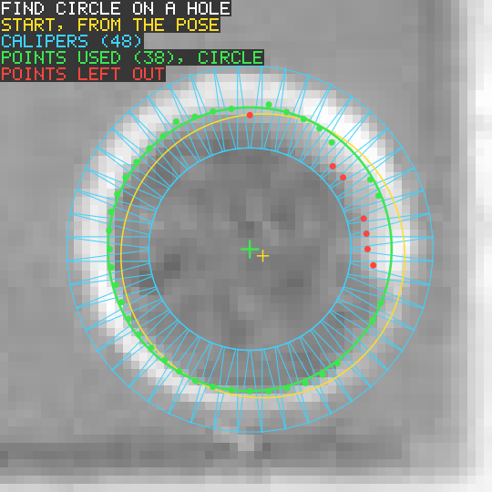
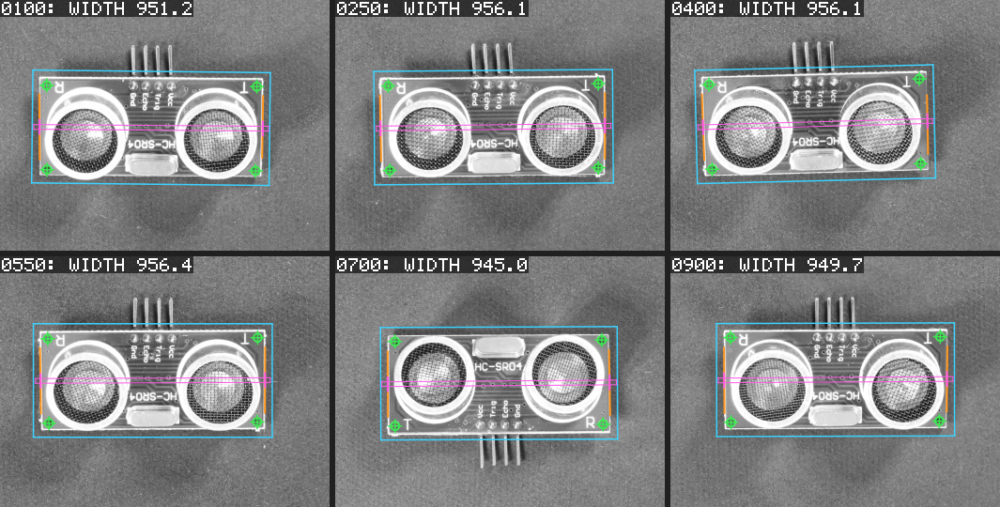

# AdaMachineVision

AdaMachineVision(AMV)は、Ada 2022 で書いたマシンビジョンライブラリです。

公開 API は、Cognex VisionPro .NET API のオブジェクトモデルと命名に倣い、Ada の流儀に置き換えています。対象は次のとおりです。

- 座標空間ツリーを持つ画像
- 図形と領域
- `RunParams` / `Run` / `Results` / `RunStatus` を持つツール

VisionPro のアプリケーションを、ほぼ機械的な書き換えで移植できることを目指しています(例:`CogBlobTool` → `Ks_Blob_Tool`)。

この API の裏側は、すべて独立したクリーンルーム実装です。Cognex のコード、バイナリ、ヘッダ、ドキュメントの文章は使っていません。

> AMV は Cognex Corporation と提携しておらず、同社の承認も受けていません。
> 「Cognex」と「VisionPro」は Cognex Corporation の商標です。

## 検出例

サンプルプログラムが書き出した画像です。入力の写真の上に、AMV のツールが見つけたものを描いています。緑はツールが見つけたもの、水色とマゼンタはツールが探した範囲、赤は外したものです。

| 基板がどう置かれていても測る | 同じ種類のものを複数見つける |
|---|---|
|  |  |
| PMAlign が基板を見つけます(この写真では上下が逆)。その姿勢を使って、別の基板で一度だけ教えた位置にツールを置きます。Find Circle が 4 つの穴を、Find Line が 2 本の外形線を、Caliper が幅を測ります。 | PMAlign が 4 つのティーライトを見つけます。それぞれの姿勢で Find Circle を置き、縁の円を測ります。 |

| コインを数える | 細胞核を数えて、数を確かめる |
|---|---|
|  |  |
| 背景は上のほうが明るく、しきい値だけではコインと背景がつながります。先にトップハットで背景を平らにすると、Blob が 24 枚のコインを見つけます。 | 人が手で描いた核は 115 個で、Blob が見つけたブロブは 98 個です。橙の十字は、自分のブロブがない 17 個の核です。Blob は接している核を分けません。暗すぎてしきい値に届かない核もあります。 |

| Find Circle が穴を求める仕組み | 同じ設定で 6 枚の基板を測る |
|---|---|
|  |  |
| 48 本のキャリパ(水色)が穴の縁を横切ります。見つけたエッジ点に円(緑)を当てはめ、円から遠い点(赤)は外します。黄色の円は、姿勢から決めたツールの開始位置です。 | パターンもツールの設定も 1 組だけです。基板はずれたり回ったりしていて、1 枚は上下が逆です。 |

各サンプルの手順ごとの画像、設定、測定値は [`examples/real_images/README.md`](examples/real_images/README.md)(英語)にあります。合成画像を使うサンプルは [`examples/README.md`](examples/README.md)(英語)にあります。

写真の出典は次のとおりです。グレーに変換して大きさを変え、AMV の結果を描き込んでいます。画像ごとの出典とライセンスは [`docs/images/README.md`](docs/images/README.md)(英語)に載せています。

- VisA(Zou ほか、ECCV 2022。Amazon。CC BY 4.0)
- BBBC039(Broad Bioimage Benchmark Collection。CC0 1.0)
- scikit-image の `coins`(Brooklyn Museum 所蔵。既知の著作権上の制限はありません)

## 現状

版 0.1.0 で、最初のリリースです(C の ABI の版は 2)。内容とその後の変更は `CHANGELOG.md`(英語)に記録しています。

- **コア:** 実装とテストが済んでいるのは次のとおりです。
  - 変換、座標空間ツリー
  - 8/16 ビットのグレー画像とプレーナカラー画像
  - 画像ファイル(PNM、BMP)
  - 図形と領域、浮動小数点の画像演算、幾何のフィット
  - ツールの枠組み
- **ビジョンツール:** 次のツールの実装とテストが済んでいます。
  - Blob、Caliper、Find Line / Find Circle
  - Dimensioning(測定ツール、フィット、形状生成ツール)
  - Image Processing(フィルタ系、1 画像のオペレータ、幾何系)
  - CNL Search、PMAlign
  - CalibFix(Fixture、N 点キャリブレーション、チェッカーボード・キャリブレーション)
  - ToolGroup / ToolBlock

  名前は VisionPro 9.23 のリファレンスに合わせています。対応と相違点(未提供のものを含む)は、すべて `docs/API_MAPPING.md` に載せています。PMAlign の探索は公開文献に基づく AMV 独自の手法で、Cognex の PatMax や PatQuick ではありません。
- **証明:** ロジックはすべて SPARK のカーネルにあります。どのカーネルも、任意の入力で実行時エラーが起きないことを gnatprove で証明しています。`docs/PROOF.md` に挙げた性質については、機能的な正しさも証明しています。チェックは 34514 項目で、すべて証明済みです。`pragma Assume` も、正当化で済ませたチェックもありません。証明していない部分(薄い Ada API、画素の共有の参照カウント、確保・C のメモリとのコピー・ストリームの変換を行う小さな補助)は、同じファイルに列挙しています。
- **v0.1 の対象外:** バーコード(ID)と OCR。

## 設計の要点

- **カーネル:** ロジックはすべて SPARK のカーネル(`AMV.Kernels.*`)に置きます。
  - 入口は C 互換の型を受け取り、入力をすべて検査し、失敗を例外ではなく状態値で返します。
  - 入口は C の呼び出し規約で公開しています。つまり、**カーネルの入口がそのまま C API です**(`include/amv.h`)。
- **Ada の API:** `AMV.Transforms`、`AMV.Images` などは、入口を呼んで、失敗の状態値を対応する `Ks_` 例外に変えるだけの薄い層です。薄さは `make check` で確かめています。
- 拘束力のある規則は `docs/DESIGN.md` にあります。

## 例

```ada
with Ada.Text_IO;
with AMV;
with AMV.Image_File;
with AMV.Images;
with AMV.Misc;
with AMV.Transforms;

procedure Quick_Look is
   Image : AMV.Images.Ks_Image_8_Grey := AMV.Images.Create (64, 48);
   X, Y  : AMV.Real;
begin
   Image.Set_Pixel (X => 10, Y => 20, Value => 255);

   --  ルートの下に fixture 空間を作る。変換は fixture の座標をルート
   --  (親)の座標へ写す(Parent_From_New)。fixture の原点はルートの
   --  (5, 3) にあり、軸は 30 度回っている。
   Image.Coordinate_Space_Tree.Add_Space
     ("@", "Fixture",
      AMV.Transforms.Create_Rigid (AMV.Misc.Deg_To_Rad (30.0), 5.0, 3.0));
   Image.Set_Selected_Space_Name ("@\Fixture");

   --  画素 (10, 20) の中心は、選択中の空間でどこか。
   Image.Get_Transform (".", "#").Map_Point (10.0, 20.0, X, Y);
   Ada.Text_IO.Put_Line (X'Image & Y'Image);

   AMV.Image_File.Write_Image ("quick_look.pgm", Image);
end Quick_Look;
```

出力は ` 1.28301270189222E+01 1.22224318643355E+01` です。画素 (10, 20) の中心は、fixture の座標でおよそ (12.83, 12.22) にあります。プログラム全体は `examples/quick_look.adb` にあります。C からは、同じ変換を `ks_transform_2d_linear_*` 関数として使えます(`include/amv.h`)。

## ビルド

**必要なもの:**

- GNAT 16.1 と gprbuild 26(GNAT FSF builds や Alire など)
- 証明には gnatprove 16.1
- GNAT 14 でも Ada のビルドとテストは通ります。
- ほかの依存はありません。

```
make build       # ライブラリ:build/lib/libamv.a
make test        # Ada のテストと C API のテスト
make check       # 警告をエラーとして全部ビルドし、API の薄さを検査する
make prove       # SPARK のカーネルを証明する(gnatprove)
make examples    # build/bin/quick_look、blob_inspection など
make run-examples  # サンプルを実行し、結果を確かめる
make test-real-images  # 公開画像を取得して実画像テストを実行する
make run-real-image-examples  # その画像でサンプルを実行する
make pictures    # docs/images の結果画像を作り直す
```

テストはリポジトリのルートから実行してください(`tests/output/` に書き出すものがあります)。

## リポジトリの構成

```
src/             ライブラリ:AMV.*(Ada の API)と AMV.Kernels.*(SPARK のカーネル)
include/amv.h    C API
tests/           Ada のテスト(test_suite が全部を実行)と tests/c(C API)
examples/        サンプルプログラム。examples/real_images は写真を使うもの
tools/           開発用のツール(API の薄さの検査)
docs/            DESIGN.md(拘束力のある規則)、PROOF.md、API_MAPPING.md、
                 images/(README に載せている結果画像)、
                 handoff/(計画とメモ。日本語)
```

## ドキュメント

- `docs/DESIGN.md`:すべてのパッケージが従う設計規則。9 節は SPARK のカーネルと C API の規則です。
- `docs/PROOF.md`:何を証明し、何を信頼していて、どこに限界があるか。
- `docs/API_MAPPING.md`:VisionPro の名前と、それに対応する AMV の名前。
- `CHANGELOG.md`:各リリースの内容と変更点(英語)。
- `examples/README.md` と `examples/real_images/README.md`:サンプルと、その検出結果の画像(英語)。
- `tests/real_images/README.md`:実画像テストの画像とライセンス、調整用と評価用を分ける手順。
- `docs/images/README.md`:結果画像の一覧と、元の写真の出典とライセンス(英語)。

## ライセンス

AMV はデュアルライセンスです。

- **非商用の利用**は、[PolyForm Noncommercial License 1.0.0](LICENSE.md) のもとで無償です。個人の学習、趣味の制作、研究、教育のほか、ライセンスが挙げる非営利の組織による利用が当たります。
- **商用の利用**には、著作権者との有償の商用ライセンスが要ります。

2 つの選択肢と、商用ライセンスの問い合わせ先は [`LICENSING.ja.md`](LICENSING.ja.md) にあります。ソースは公開していますが、無償のライセンスが商用利用を除くので、「オープンソースの定義」でいうオープンソースではありません。
