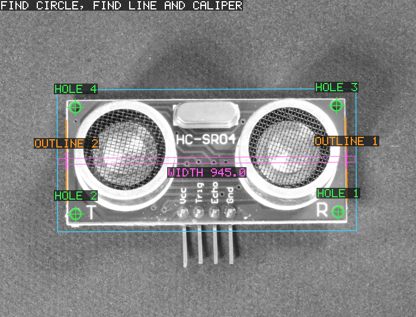
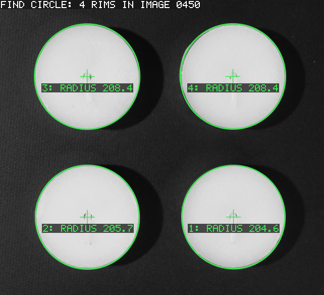
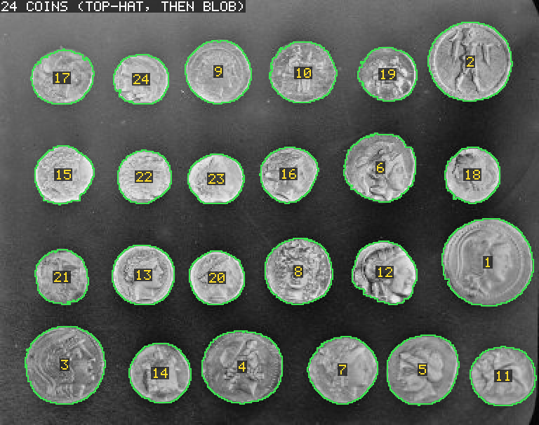
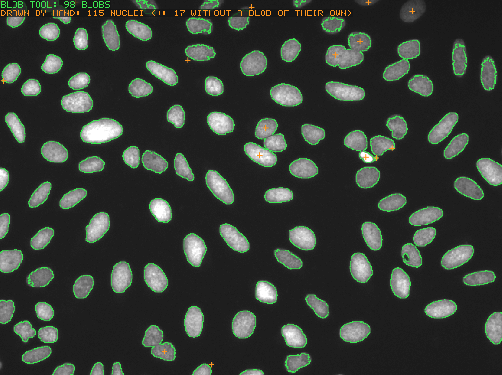
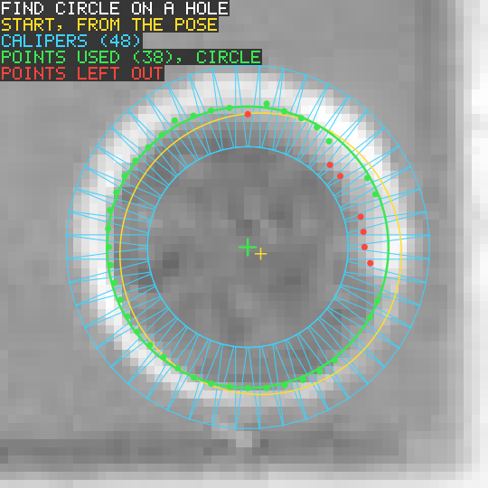
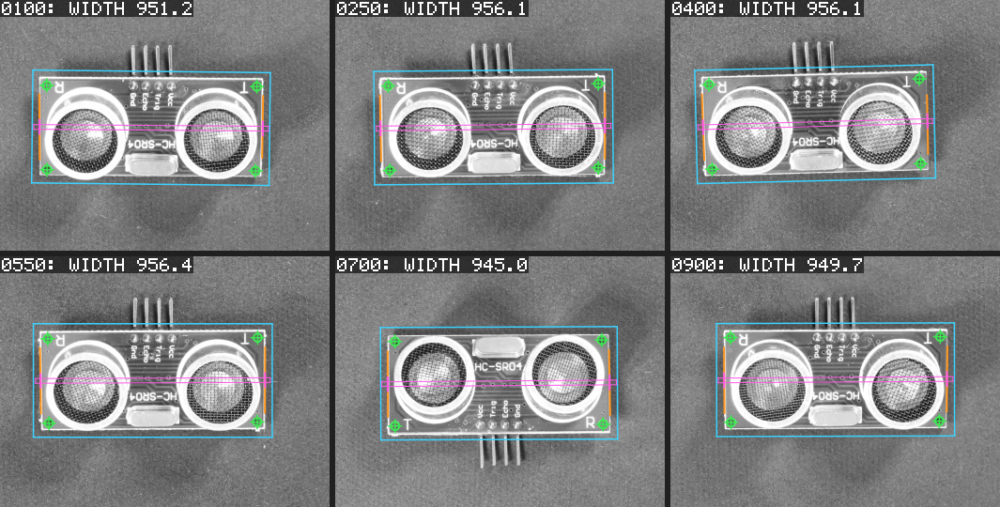

# AdaMachineVision

AdaMachineVision (AMV) is a machine vision library written in Ada 2022.
Its public interface follows the object model and naming of the Cognex
VisionPro .NET API — images with coordinate space trees, shapes and
regions, tools with `RunParams` / `Run` / `Results` / `RunStatus` —
mapped to Ada conventions, so that VisionPro applications can be ported
with a mostly mechanical translation (`CogBlobTool` becomes `Ks_Blob_Tool`).

Everything behind that interface is an independent, clean-room
implementation. No Cognex code, binaries, headers or documentation text
are used.

> AMV is not affiliated with or endorsed by Cognex Corporation.
> "Cognex" and "VisionPro" are trademarks of Cognex Corporation.

## What it finds

Pictures written by the example programs: the input photograph with what
AMV's tools found drawn on it. Green is what a tool found, cyan and
magenta where it looked, red what it left out.

| Gauging a board wherever it lies | Several objects of one kind |
|---|---|
|  |  |
| PMAlign finds the board, here lying upside down. The pose it reports places Find Circle on the four holes, Find Line on the two outlines and a Caliper across the width, all taught once on another board. | PMAlign finds the four tea lights, and each result's pose places a Find Circle, which measures the rim. |

| Counting coins | Counting nuclei, and checking the count |
|---|---|
|  |  |
| The background is brighter at the top, so a threshold alone merges a coin with it. A top-hat flattens the background first, and Blob finds the 24 coins. | Blob finds 98 blobs where 115 nuclei were drawn by hand. The orange crosses mark the 17 nuclei without a blob of their own: a blob tool does not split nuclei that touch, and some are too dim for the threshold. |

| How Find Circle gets a hole | The same settings on six boards |
|---|---|
|  |  |
| 48 calipers (cyan) cross the hole's edge. The circle (green) is fitted to the edge points they find; the points farthest from it are left out (red). The yellow circle is where the pose put the tool. | One pattern and one set of tool settings; the boards are shifted, turned and, in one photograph, upside down. |

Every step of these examples, with its picture, the settings and the
measured values, is in
[`examples/real_images/README.md`](examples/real_images/README.md); the
examples on synthetic images are in
[`examples/README.md`](examples/README.md). The photographs are from
VisA (Zou et al., ECCV 2022; Amazon; CC BY 4.0), BBBC039 (Broad Bioimage
Benchmark Collection; CC0 1.0) and scikit-image's `coins` (Brooklyn
Museum; no known copyright restrictions), converted to grey and resized,
with AMV's results drawn on them:
[`docs/images/README.md`](docs/images/README.md) names the source and
the licence of each picture.

## Status

Version 0.1.0, the first release (C ABI version 2). `CHANGELOG.md` lists
what it contains and every change since.

* **Core:** transforms, coordinate space trees, 8/16-bit grey and planar
  colour images, image files (PNM, BMP), shapes and regions, floating
  point image maths, geometry fitting and the tool framework are
  implemented and tested.
* **Vision tools:** Blob, Caliper, Find Line / Find Circle, the
  Dimensioning measuring, fitting and shape creation tools, the Image
  Processing filter, one-image and geometry tools, CNL Search, PMAlign,
  CalibFix (fixtures, N-point and checkerboard calibration) and
  ToolGroup / ToolBlock are implemented and tested. Their names follow
  the VisionPro 9.23 reference; `docs/API_MAPPING.md` lists every
  counterpart and every departure, including what is not provided yet.
  PMAlign's search is AMV's own method from the public literature, not
  Cognex's PatMax or PatQuick.
* **Proofs:** all logic lives in SPARK kernels, and every kernel is
  proved free of run-time errors for any input (and, for the facts listed
  in `docs/PROOF.md`, functionally correct): 34514 checks, all proved,
  with no `pragma Assume` and no justified checks. What is trusted
  without proof (the thin Ada API, the reference counting of shared
  pixels, and small helpers for allocation, copies to and from C memory
  and stream conversions) is listed there.
* **Not in v0.1:** barcodes (ID) and OCR.

## Design in one paragraph

All logic lives in SPARK kernels (`AMV.Kernels.*`). Their entry points take
C-compatible types, check every input and report failures as a status
instead of raising, and they are exported with the C calling convention:
**the kernels' entry points are the C API** (`include/amv.h`). The Ada API
(`AMV.Transforms`, `AMV.Images`, ...) is a thin layer that calls them and
turns a failed status into the matching `Ks_` exception; `make check`
verifies that it stays thin. The binding rules are in `docs/DESIGN.md`.

## Example

```ada
with Ada.Text_IO;
with AMV;
with AMV.Image_File;
with AMV.Images;
with AMV.Misc;
with AMV.Transforms;

procedure Quick_Look is
   Image : AMV.Images.Ks_Image_8_Grey := AMV.Images.Create (64, 48);
   X, Y  : AMV.Real;
begin
   Image.Set_Pixel (X => 10, Y => 20, Value => 255);

   --  A fixture space under the root. The transform maps fixture
   --  coordinates into the root (Parent_From_New): the fixture's origin
   --  is at (5, 3) and its axes are turned by 30 degrees.
   Image.Coordinate_Space_Tree.Add_Space
     ("@", "Fixture",
      AMV.Transforms.Create_Rigid (AMV.Misc.Deg_To_Rad (30.0), 5.0, 3.0));
   Image.Set_Selected_Space_Name ("@\Fixture");

   --  The centre of pixel (10, 20) in the selected space.
   Image.Get_Transform (".", "#").Map_Point (10.0, 20.0, X, Y);
   Ada.Text_IO.Put_Line (X'Image & Y'Image);

   AMV.Image_File.Write_Image ("quick_look.pgm", Image);
end Quick_Look;
```

It prints ` 1.28301270189222E+01 1.22224318643355E+01`: the centre of
pixel (10, 20) is at about (12.83, 12.22) in fixture coordinates. The full
program is `examples/quick_look.adb`. From C, the same transforms
are available as `ks_transform_2d_linear_*` functions (`include/amv.h`).

## Building

Requirements: GNAT 16.1 and gprbuild 26 (for example the GNAT FSF builds or
Alire), and gnatprove 16.1 for the proofs. GNAT 14 builds and tests the
Ada code too. There are no other dependencies.

```
make build       # the library: build/lib/libamv.a
make test        # Ada tests and the C API tests
make check       # everything with warnings as errors, plus the thin-API check
make prove       # prove the SPARK kernels (gnatprove)
make examples    # build/bin/quick_look, blob_inspection, ...
make run-examples  # run the examples and check their reports
make test-real-images  # fetch public images and run the real-image tests
make run-real-image-examples  # run the examples on those images
make pictures    # write the result pictures of docs/images again
```

Run the tests from the repository root (some write under `tests/output/`).

## Repository layout

```
src/             the library: AMV.* (Ada API) and AMV.Kernels.* (SPARK kernels)
include/amv.h    the C API
tests/           Ada tests (test_suite runs them all) and tests/c (C API)
examples/        example programs; examples/real_images runs on photographs
tools/           development tools (the thin-API check)
docs/            DESIGN.md (binding rules), PROOF.md, API_MAPPING.md,
                 images/ (the result pictures the READMEs show),
                 handoff/ (plans and notes, in Japanese)
```

## Documentation

* `docs/DESIGN.md`: the design rules every package follows, including the
  SPARK kernel and C API rules (section 9).
* `docs/PROOF.md`: what is proved, what is trusted, and the limits.
* `docs/API_MAPPING.md`: VisionPro names and their AMV counterparts.
* `CHANGELOG.md`: what each release contains and changes.
* `examples/README.md` and `examples/real_images/README.md`: the
  examples, with pictures of what they find.
* `tests/real_images/README.md`: the real-image tests, their images and
  licences, and the tuning and evaluation protocol.
* `docs/images/README.md`: the result pictures, and the source and
  licence of the photograph under each.

## License

AMV is dual-licensed:

* **Noncommercial use** is free under the
  [PolyForm Noncommercial License 1.0.0](LICENSE.md): personal study,
  hobby projects, research, teaching, and use by the noncommercial
  organizations that the licence names.
* **Commercial use** needs a paid commercial licence from the copyright
  holder.

[`LICENSING.md`](LICENSING.md) explains the two options and how to ask
for a commercial licence. The source is public, but AMV is not open
source in the sense of the Open Source Definition, because the free
licence excludes commercial use.
