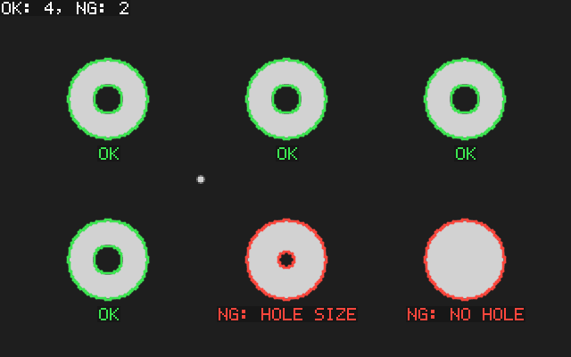
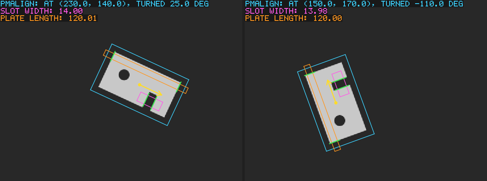

# Examples

| Program | What it shows |
|---|---|
| `quick_look.adb` | An image, a fixture coordinate space under the root, a point mapped from pixel space into the selected space, and writing a PGM file |
| `blob_inspection.adb` | Blob analysis: find washers, filter out dust and holes by area, find each washer's holes among its children and judge it by their number and size. Reads an image file given as an argument, or inspects a synthetic one |
| `align_and_measure.adb` | The usual gauging chain: PMAlign locates a part at any angle, the fixture tool puts the part's coordinate space on the image at the found pose, and calipers set once in part coordinates measure a slot and the plate length in every scene, with a tolerance check |
| `c/c_blob_inspection.c` | The blob inspection through the C API (`include/amv.h`): `adainit`, `ks_status` checks, run parameters, results and the destroy functions |
| [`real_images/`](real_images/README.md) | The tools on photographs: counting coins and cell nuclei (Blob), gauging a circuit board wherever it lies (PMAlign, Find Circle, Find Line, Caliper), and finding four tea lights and their rims (PMAlign, Find Circle), with a picture of every step |

## What the examples find

The examples write a picture of their results: the input image with what
the tools found drawn on it. Below are the pictures of the two examples
that paint their own input; those of the examples on photographs are in
[`real_images/README.md`](real_images/README.md).

### `blob_inspection`

Each washer the blob tool found is outlined (`Get_Boundary`) together
with the holes found among its children, in green when it passes and in
red when it does not, and the verdict is written under it. The small dot
left of the middle is dust: the area filter drops it, so it gets no
outline.

### `align_and_measure`

The same plate at two poses. In each scene:

* **cyan**: the pattern's train region, drawn at the pose PMAlign
  found, and that pose as text;
* **yellow**: the origin and the first axis of the part's coordinate
  space, which the fixture tool puts on the image;
* **magenta** and **orange**: the two calipers, set once in part
  coordinates, and the widths they measure;
* **green**: the two edges each caliper found.

## Building and running

`example_support.ads` holds what the examples share: painting a part
given by a membership test at a pose, with anti-aliased edges (so that
the first examples need no image files), finding the images of the
examples on photographs, and number formatting. `example_draw.ads` draws
the result pictures: lines, circles, outlines, marks and text on a colour
picture made from a grey image. It is plain Ada for the examples only;
AMV itself models geometry, not graphics.

Build them with `make examples` (the Ada examples are listed in
`amv_examples.gpr`, the C one in `amv_c_examples.gpr`, `for Main use
(...)`) and run them from any directory, for example
`./build/bin/align_and_measure`. They write their images (PGM) and
result pictures (BMP) into the current directory.

`make run-examples` builds them, runs them in `build/example-run` and
checks their reports; `make run-real-image-examples` does the same for
the examples on photographs, after fetching the images. CI runs both on
every pull request. `make pictures` then converts the result pictures to
the PNG files in `docs/images` that the READMEs show.
