# Examples on real images

Four programs that run AMV's tools on photographs from open collections
and write pictures of what the tools found, drawn on the photograph. The
pictures below are those pictures, as the programs wrote them.

| Program | Tools | Image |
|---|---|---|
| [`coin_count.adb`](#coin_count-counting-coins) | IP One Image (top-hat), Blob | a photograph of coins |
| [`pcb_gauging.adb`](#pcb_gauging-gauging-a-board-wherever-it-lies) | PMAlign, Find Circle, Find Line, Caliper | a circuit board, shifted and turned |
| [`candle_rims.adb`](#candle_rims-several-objects-of-one-kind) | PMAlign (several results), Find Circle | four tea lights |
| [`nuclei_count.adb`](#nuclei_count-counting-nuclei-and-checking-the-count) | Blob | a microscope field of cell nuclei |

In every picture:

* **green** is what a tool found: a blob's outline, a fitted circle or
  line, the edge points a fit used;
* **red** is what is wrong or was left out: the blobs of a threshold
  that fails, the edge points a fit dropped;
* **cyan** is where a tool looked: a pattern's train region, the
  calipers of Find Circle and Find Line; **magenta** is the caliper
  across a width;
* **yellow** is what PMAlign trained and reports (the features, the
  scores) and where a pose puts a tool before the tool runs;
* **orange** is a second kind of result beside the green one: the
  board's outlines, the nuclei that have no blob of their own.

```
make run-real-image-examples   # fetch the images, build, run, check
```

runs the four in `build/example-run`, where they leave their reports
(`*.txt`) and pictures (`*.bmp`). By hand: `make fetch-real-images`,
`make examples`, then for example
`AMV_REAL_IMAGES=$PWD/build/real-images ./build/bin/coin_count` (without
the variable they look in `build/real-images` under the current
directory). `example_draw.ads` in `examples/` does the drawing: plain Ada
on a colour image, for the examples only.

## `coin_count`: counting coins

A top-hat flattens an uneven background, then a blob tool with a fixed
threshold finds the coins.

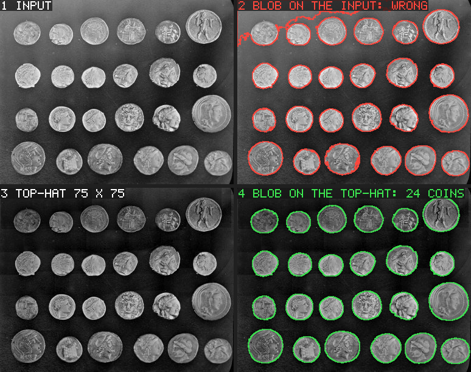

1. The input. The background is brighter at the top than at the bottom.
2. A blob tool on the input itself (threshold from the histogram): the
   bright top of the background merges with a coin into one blob, and the
   dark sides of the bottom coins are cut off.
3. The top-hat (`Grey_Morphology_NxM`, `Original_Minus_Open`, 75 x 75):
   the image minus its grey opening by a square larger than any coin. The
   coins stay; the background becomes flat and dark.
4. The blob tool on the top-hat (fixed threshold 60, area 600 to 6000,
   elongation up to 1.6): the 24 coins.

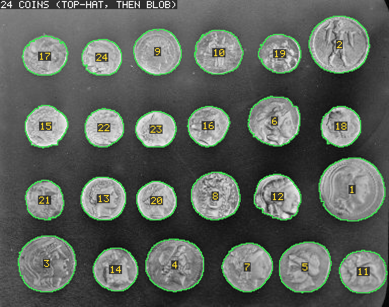

The result on the input, enlarged twice: each coin's boundary
(`Get_Boundary`) and its rank by area.

## `pcb_gauging`: gauging a board wherever it lies

The usual chain of a gauging application, on seven photographs of one
kind of board: PMAlign finds the board, and the pose it reports places
the measuring tools, which were set up once on the first image.

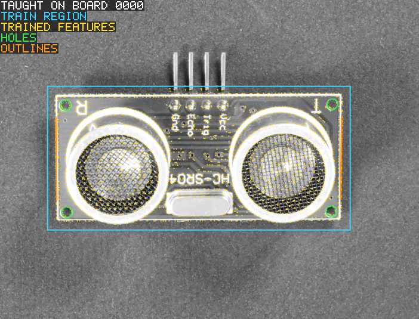

**1. Teaching, on board 0000.** The pattern is trained in the cyan
region (the yellow dots are its trained features). The four mounting
holes and two stretches of the outline are taught there once.

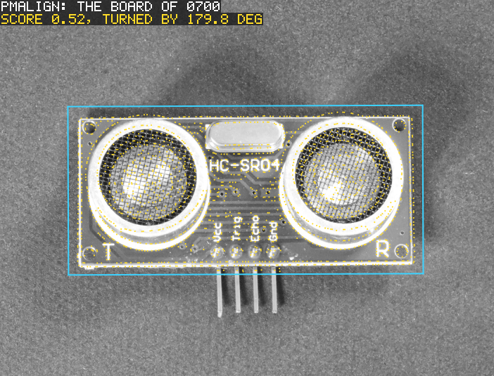

**2. Finding another board.** Board 0700 lies upside down. PMAlign
reports the pose (here turned by 179.8 degrees), and the features drawn
through that pose fall on the board's edges.

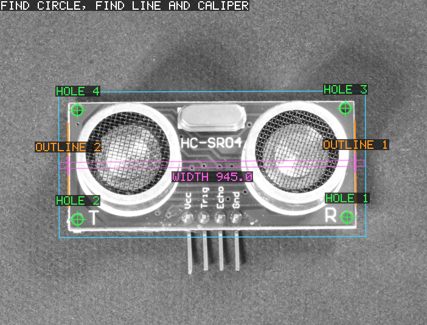

**3. Measuring.** The pose maps each taught hole and outline into this
image, where Find Circle and Find Line start; a Caliper in pair mode
measures the width across the board. Hole 1 is the hole that was taught
as hole 1: the numbers turn with the board.

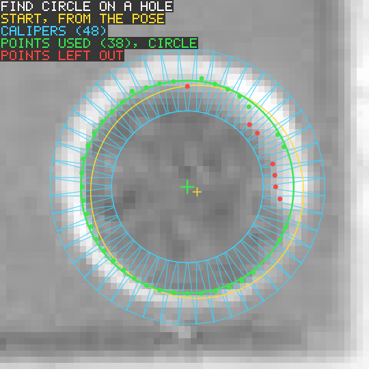

**4. How Find Circle gets a hole.** 48 calipers (cyan) cross the hole's
edge, each looking outwards for the step from the dark hole to the light
pad. The circle is fitted to the edge points they find (green); the 7
points farthest from it are left out (red). The yellow circle is where
the pose put the taught hole, the green one the result.

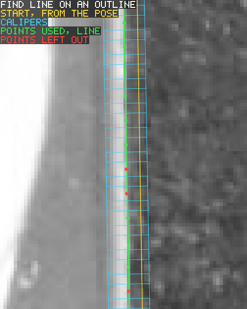

**5. How Find Line gets an outline.** The same with 40 calipers along
the taught stretch and a line fitted to their edge points.

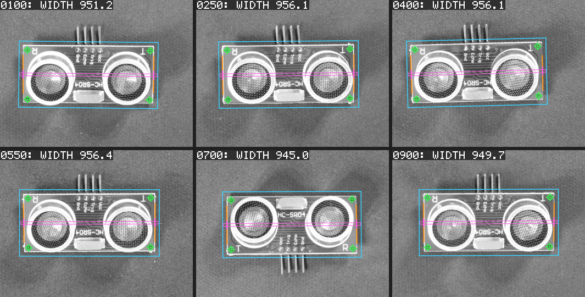

**All six boards.** One set of settings; the boards are shifted, turned
by up to 1.3 degrees and, for 0700, turned upside down.

| Board | Score | Turned (degrees) | Hole radii (px) | Width (px) |
|---|---|---|---|---|
| 0100 | 0.62 | 0.6 | 17.35 – 17.49 | 951.23 |
| 0250 | 0.54 | -0.5 | 16.54 – 16.98 | 956.08 |
| 0400 | 0.53 | -1.3 | 17.09 – 17.36 | 956.15 |
| 0550 | 0.67 | 0.0 | 16.75 – 17.15 | 956.39 |
| 0700 | 0.52 | 179.8 | 17.18 – 17.40 | 944.99 |
| 0900 | 0.50 | -0.2 | 17.20 – 17.35 | 949.70 |

The widths are in pixels of each photograph. These are six boards, not
one: their routed outlines differ a little, and so does the scale of the
photographs (in 0700 the holes are 886 px apart, in the others 894 to
896). How the real-image tests judge these measures against references
measured independently of AMV is in
[`tests/real_images/README.md`](../../tests/real_images/README.md).

## `candle_rims`: several objects of one kind

PMAlign returns several results, and each result's pose places a Find
Circle.

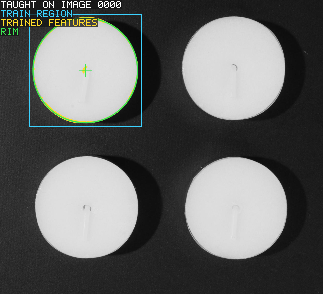

**1. Teaching.** The pattern is trained on the top left light of image
0000, and its rim is taught there.

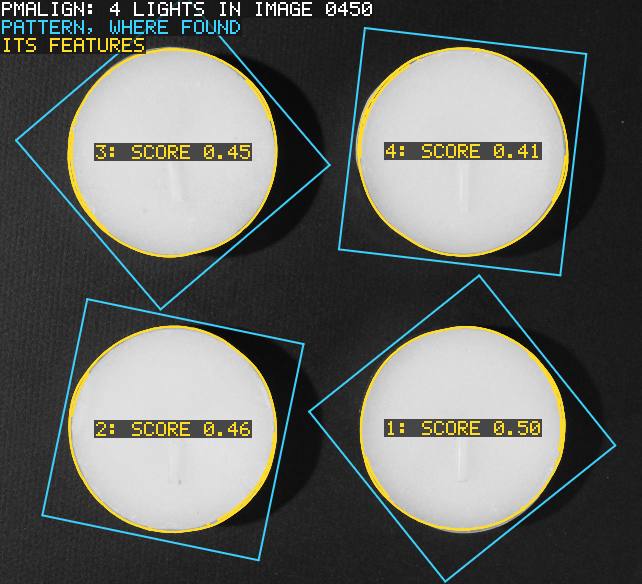

**2. Four results.** In image 0450 PMAlign finds the four lights
(`Approximate_Number_To_Find` 4, any angle), with scores of 0.41 to
0.50. A tea light looks nearly the same from every side, so the angle of
a result means little here; its position is what places the next tool.

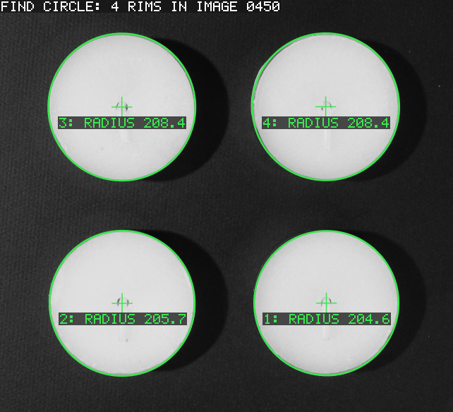

**3. The rims.** Find Circle, started from the taught rim mapped by each
pose, fits each rim: radii 204.6 to 208.4 px.

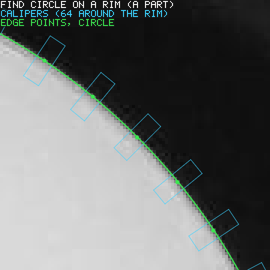

**4. A part of one rim.** 64 calipers cross the rim, each looking
outwards for the step from the light rim to the dark tray. Here every
edge point takes part in the fit: the rims are not perfectly round, and
leaving the farthest points out would pull the circle to one side.

`candle_rims 0600` (or another image number of
`tests/real_images/visa.txt`) runs it on another photograph.

## `nuclei_count`: counting nuclei, and checking the count

A blob tool counts stained cell nuclei in a microscope image, and the
count is compared with the nuclei someone drew by hand (the data set
comes with a mask of every nucleus).

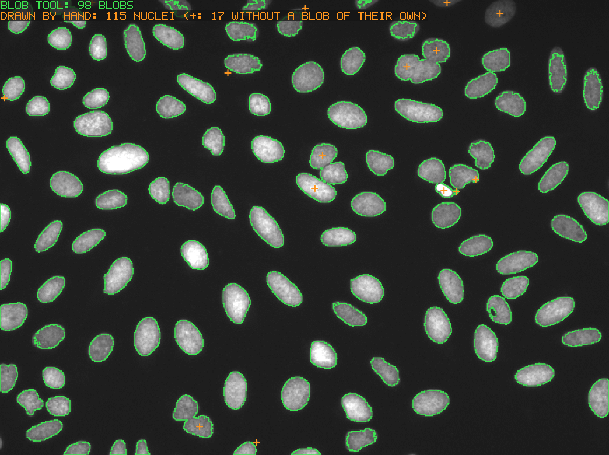

Green: the blobs (threshold from the histogram, sets of fewer than 30
pixels dropped). Orange crosses: nuclei of the hand-drawn masks that
have no blob of their own. The picture's grey levels are multiplied by 3
so that the dim nuclei can be seen; the tool works on the image as it is.

In this field (`eval_07`) the tool finds 98 blobs where 115 nuclei were
drawn: 17 nuclei have no blob of their own. Some touch a neighbour and
come out as one blob with it (a blob tool does not split touching
objects); the others are too dim for the threshold or lie at the image
border. The real-image tests run ten evaluation fields. On nine of them
9 % to 24 % of the nuclei have no blob of their own, and this field is
the median of those nine; on the tenth (`nuclei_count eval_02`, small
dim nuclei) a global threshold fails, with 77 % missed. The table is in
[`tests/real_images/README.md`](../../tests/real_images/README.md).

## Where the images come from

The photographs are not in this repository: `make fetch-real-images`
downloads them, pinned and checked by SHA-256
(`tests/real_images/*.txt`), and converts them into
`build/real-images`.

| Example | Image | Source | Licence |
|---|---|---|---|
| `coin_count` | `coins.png` | scikit-image `data` ("Greek coins from Pompeii", Brooklyn Museum) | no known copyright restrictions |
| `pcb_gauging` | `visa_pcb1_*.jpg` | VisA (Zou et al., ECCV 2022), Amazon, category `pcb1` | CC BY 4.0 |
| `candle_rims` | `visa_candle_*.jpg` | VisA (Zou et al., ECCV 2022), Amazon, category `candle` | CC BY 4.0 |
| `nuclei_count` | `bbbc039_*.pgm` | BBBC039v1 (Ljosa et al., Nature Methods 2012), Broad Bioimage Benchmark Collection | CC0 1.0 |

The pictures on this page are in `docs/images`;
[its README](../../docs/images/README.md) names the source and the
licence of each and what was changed. `make pictures` makes them again.
