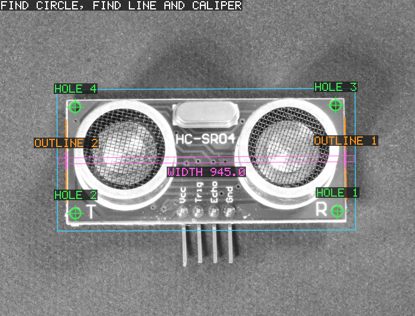
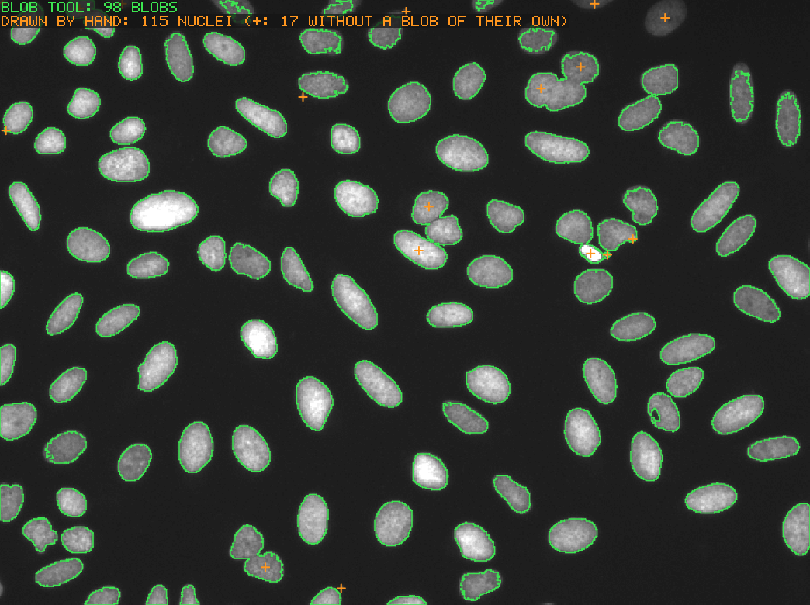
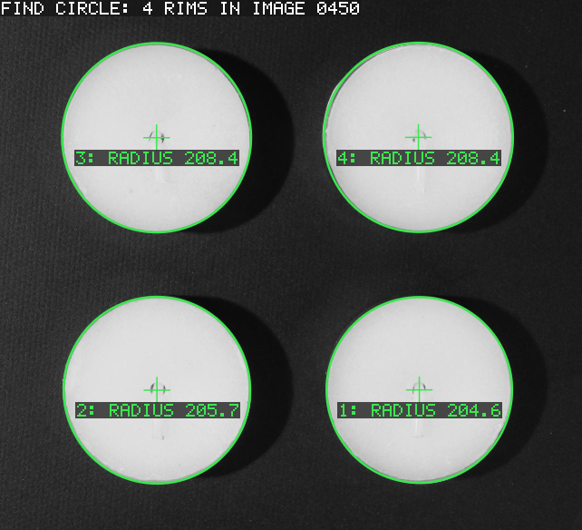

# Real-image tests

`test_real_images` runs AMV's tools on real images: camera photos, a scan
and printed targets, from open sample collections. The synthetic images of
the other tests have exact ground truth but none of the texture, clutter,
blur, lighting gradients, perspective and lens distortion of real images,
which is where several defects showed up (see below).

```
make test-real-images     # fetch, convert, build and run
```

`make fetch-real-images` (`tools/fetch_real_images.sh`) downloads the files
listed in the manifests (`*.txt` here), pinned to a commit or an archive
and checked by SHA-256, into `build/real-images/raw`, and converts each to
a 24-bit BMP in `build/real-images` (AMV reads PNM and BMP only); members
of large archives are fetched by byte range. It needs `curl` and
ImageMagick (`magick` or `convert`), or `sips` on macOS, and `python3` for
the BBBC006 images (16-bit TIFFs inside zip archives, written as 16-bit
PGMs by `tools/zip_tiff_to_pgm.py`, standard library only). The images are
never committed. The test reads them from `$AMV_REAL_IMAGES`
(`build/real-images` by default). CI runs it on every pull request.

The test prints numbers. To see what the tools find, the examples of
[`examples/real_images`](../../examples/real_images/README.md) run the
same tools with the same settings on some of these images and draw the
results on them; a few of their pictures are shown in the sections
below. Those result pictures (`docs/images`) are the only pictures made
from these images that are committed.

## How the expected values are set (tuning and evaluation)

A test on real images is only an evaluation if neither the tool's
parameters nor the tolerances were fitted to the images it is judged on.
The gauging and CNL tests below follow this protocol; the older tests are
being brought to it (see "Status" at the end).

1. One set of tool parameters per series (one camera setup and kind of
   part), the same for every image; no per-image settings or tolerances.
2. The reference values are measured independently of AMV, before AMV is
   run on the image, with a separate plain-Python tool
   (`tools/real_image_reference.py`, standard library only; not part of
   the build). Rough positions are read by eye; the tool refines them.
3. Parameters and tolerance rules are chosen on tuning images only, then
   frozen; the evaluation images are measured once, after that.
4. A reference is never dropped because it is hard: where the reference
   itself is uncertain (a blurred edge), the tolerance grows with the
   reference's own fit RMS instead.
5. What fails on the evaluation images stays a failure: it is recorded as
   a known failure, checked to still fail, and reported.

## Images and licences

Four manifests list the images: `images.txt` (open images, below),
`visa.txt` (VisA, Amazon, CC BY 4.0; members of its archive fetched by
byte range), `bbbc006.txt` (BBBC006 of the Broad Bioimage
Benchmark Collection, CC0 1.0; members of its zip archives fetched by
byte range) and `bbbc039.txt` (BBBC039, the same collection, CC0 1.0;
images and hand-drawn masks fetched by byte range, the masks turned into
label images by `tools/zip_png_labels.py`).

| File | Source | Licence |
|---|---|---|
| `left01.jpg` … `left14.jpg` (no `left10`) | OpenCV `samples/data` | BSD-3-Clause / Apache-2.0 (OpenCV) |
| `chessboard.png`, `box.png`, `box_in_scene.png`, `smarties.png`, `gauge-1.jpg` | OpenCV `samples/data` | BSD-3-Clause / Apache-2.0 (OpenCV) |
| `coins.png` | scikit-image `data` ("Greek coins from Pompeii", Brooklyn Museum) | no known copyright restrictions |
| `visa_pcb1_*.jpg` | VisA (Zou et al., ECCV 2022), category `pcb1` | CC BY 4.0 |
| `visa_candle_*.jpg` | VisA (Zou et al., ECCV 2022), category `candle` | CC BY 4.0 |
| `bbbc006_*.pgm` | BBBC006v1 (Ljosa et al., Nature Methods 2012), nuclei at 17 focal planes | CC0 1.0 |
| `bbbc039_*.pgm` | BBBC039v1 (Ljosa et al., Nature Methods 2012), U2OS nuclei with hand-drawn masks | CC0 1.0 |

Debian ships OpenCV's sample images as free software and excludes only the
`lena` images, none of which is used here.

## What is checked, and where the expected values come from

None of these images comes with ground truth, so the expected values were
measured by eye or with an independent measurement, as noted. Tolerances
leave room for the small differences between JPEG decoders.

| Test | Image | Expected |
|---|---|---|
| Reading | all | the size of every converted image |
| Blob after a top-hat | `coins.png` | 24 coins (the ones in the photo), one blob within 6 px of each coin centre, which were measured by eye (± 3 px). A plain threshold merges a coin with the brighter top of the background; the top-hat (the image minus its grey opening by 75 × 75) flattens it first |
| Blob | `smarties.png` | 14 sweets: 13 blobs, of which one is the touching pair near (125, 265), four touch the image border, and eight are single round sweets (area 1900–2700, elongation < 1.4) |
| Find Circle | `gauge-1.jpg` | the dial face: centre (125.5, 134.5) ± 2 and radius 96 ± 2, from the face's extent in a threshold of the image (x 28.5–222.5, y 39.5–229.5); the same circle (centre ± 1.5 px, radius ± 1 px) from three different starting guesses (the slightly oblique dial is a little elliptical) |
| PMAlign | `box.png` in itself | found at the origin (± 0.05), coverage ≈ 1 and score ≥ 0.9 |
| PMAlign | `box.png` in `box_in_scene.png` | the box at (184, 225) ± 6, turned 8 ± 5°, scaled 0.54 ± 0.05 (the position measured by eye from its corners). The box is seen in perspective, which a similarity pose cannot follow, so the accept threshold is 0.15 |
| Checkerboard calibration | `left01` … `left14`, `chessboard.png` | the 9 × 6 inner corners: 54 corners in a 9 × 6 grid, no grid index twice, and the corners on a homography of their grid indices. The camera has barrel distortion (OpenCV's calibration of it: k1 ≈ −0.28 at f ≈ 536 px), which a homography alone leaves at 0.8–1.9 px, so the camera images are fitted with one radial term about the image centre added (RMS ≤ 0.5 px; 0.14–0.40 px measured); the rendered board with a homography alone (RMS ≤ 0.05 px; 0.010 px measured) |

### Gauging on VisA pcb1 (Find Circle, Dimensioning, Find Line, Caliper, Polar Unwrap)

The HC-SR04 board of VisA's `pcb1` category: 10 tuning images and 5
evaluation images, fetched by byte range from VisA's archive
(`visa.txt`). References (`tools/real_image_reference.py`): each mounting
hole's edge (dark hole to light pad) on 72 rays, fitted with a geometric
least-squares circle (started from several rough centres, the best fit
kept); each outline edge on 60 profiles averaged over 5 px along the edge,
fitted with a total least-squares line. The outline is defined as the
outer boundary of the board, the outermost edge where the grey level rises
towards the board's inside: the board has a light rim with an inner edge
too, the side lit obliquely shows a blurred band outside it, and the white
transducer rings come up to the edges (over them on some boards).



What the tools find on board 0700, which lies upside down (drawn by
`examples/real_images/pcb_gauging.adb`, whose tools start from board
0000's holes and outlines, mapped by the pose, as the fixture below
does).

**Where the tools are placed (the fixture).** As a recipe would place
them: board 0000's reference holes and outlines, taught once on that
board, are mapped into each board by the board's PMAlign pose (a pattern
trained on 0000). No tool starts from the board's own references, which
only judge the results. The pose is off by up to about 7 px at the holes
and outlines, so each finder runs twice: from the fixture, then from its
own first result.

Frozen settings (all images): Find Circle 48 calipers, search 10 px,
projection 3 px, outward, dark to light, contrast 20, filter half size 1
(the pad around a hole is about 4 px wide; a wider filter is pulled
towards its outer edge), 7 ignored, run twice; Find Line 40 calipers,
search 20 px and then 12 px along the first line found (it must not reach
the rings or the band outside), filter half size 1, 6 ignored, the
polarity of the outline (light to dark on the left edge, dark to light on
the right one, the calipers searching outwards). The board's width is the
distance (Dimensioning, point to line) from the left outline, halfway
between the taught left holes, to the right outline; and again with one
caliper in pair mode across the whole board through the taught holes'
centre (default pair scorer, the expected width 952 px, a 20 px
projection). The holes are also unwrapped (Polar Unwrap, radii r ± 8 about
the circle found, a 120 x 16 strip): at 12 angles the hole's edge found in
the strip must lie at the radius a caliper finds directly in the image
along the same ray (the median difference over the angles; where the edge
is faint the two can take different edges at one angle, while an error of
the mapping would move them all).

Frozen tolerances (chosen on the ten tuning boards): hole centre 0.95 px,
radius 0.5 px, distance between holes 0.8 px (1.5 times the largest
tuning error, rounded up to 0.05 px); outline position 0.15 px + S,
direction 0.06 deg + 2 S / span, width 0.3 px + S(left) + S(right), S
being the reference line's RMS; unwrap 0.1 px (median difference), with
the edge found both ways at 8 or more of the 12 angles.

| Measure | Tuning (10 boards): n, max, median | Evaluation (5 boards): n, max, median |
|---|---|---|
| hole centre (px) | 40, 0.60, 0.11 | 20, 0.71, 0.15 |
| radius (px) | 40, 0.33, 0.07 | 20, 0.43, 0.07 |
| distance between holes (px) | 30, 0.53, 0.10 | 15, 0.78, 0.14 |
| outline direction (deg) | 19, 0.25, 0.03 (and 1 known failure) | 10, 0.21, 0.07 |
| outline position (px) | 20, 1.23, 0.09 | 10, 1.01, 0.19 |
| board width, Find Line (px) | 10, 1.13, 0.14 | 5, 1.31, 0.46 |
| board width, one caliper pair (px) | 9, 1.12, 0.52 (and 1 known failure) | 5, 1.15, 0.67 |
| unwrapped hole edge, median difference (px) | 40, 0.04, 0.03 | 20, 0.05, 0.03 |

The large outline values are the blurred edges (reference RMS up to
1.7 px), each within its own tolerance.

**Known failure (tuning board 0150, right outline):** the light rim there
has small bumps (burrs, reflections) just outside it near the top. The
reference takes the outermost edge, so its line follows the bumps; Find
Line and the caliper take the rim's edge (the strongest one): about
1 degree apart in direction and 2.3 px apart in width (the reference's S
there is 1.6 px). No setting tried on the tuning boards (search lengths
12 .. 24 px, contrast thresholds 20 .. 40, a scorer preferring the
outermost edge) brings them together. The test checks that both still
fail.

**What went wrong on the way:**

* The first edge references took the strongest edge on each profile,
  which is the rim's inner edge on some sides and the outer one on others;
  the first evaluation failed on such an edge. The outline was then
  defined (the outermost inward-rising edge) for the references and the
  tool alike, the tuning redone on all images seen so far, and a fresh
  evaluation set annotated.
* The tools used to start from the board's own references, offset by a
  few pixels (holes 3 px off, outlines 3 px outside the reference line,
  the caliper on the reference holes). That handed them most of the
  answer. Placed by the fixture instead, the 0150 right outline above
  became a known failure (the old start, 3 px outside, made the calipers
  take the bumps as the reference does), and the old known failure, the
  top left hole of evaluation board 0550 (a faint pad, the calipers taking
  texture inside the hole), is now found within the tolerance (0.71 px).
* A caliper pair across the board that prefers the widest pair takes the
  light band outside the obliquely lit outline (up to 10 px out); the
  default scorer (the width nearest the expected one) is kept. The
  outline facing away from the light has a contrast of only 20 .. 30 grey
  levels on some boards, so a contrast threshold of 30 or a 10 px
  projection loses it.

### CNL Search on resampled real images

A real image is resampled with the affine transform tool (bilinear) on a
grid moved by a known sub-pixel shift; the output keeps the input's
coordinate tree, so the pattern must be found at its own origin whatever
the shift. Tuning: box.png's lettering, 8 shifts (largest location error
0.139 px, lowest score 0.70 at half-pixel shifts, where bilinear
resampling blurs the fine texture most). Frozen: location within 0.2 px,
score at least 0.5. Evaluation: the "HC-SR04" lettering of VisA pcb1 0000,
5 other shifts: largest location error 0.024 px. The accuracy depends on
the pattern: the box's fine texture gives about 0.13 px at quarter-pixel
shifts.

### CNL Search partial matches on cropped real images

The same patterns, in crops (resampled as above, at sub-pixel shifts)
whose border cuts through them, so that 12 .. 47 % of the pattern lies
outside the search area (the whole crop); the limit of the cut side is
half the trained pattern's size there, the others 0. The pattern must be
found at its origin with EdgeHit naming the cut side; with
PartialMatchReduceScore its score must not exceed the fraction of the
pattern inside (+ 0.02). The crop reaches beyond the pattern on the other
sides, since a search area smaller than the pattern gives no result.
Tuning: box.png's lettering, 8 cuts, each with and without the reduced
score: largest location error 0.178 px, lowest score 0.696. Frozen:
location within 0.3 px, score at least 0.5. Evaluation (run once): the
"HC-SR04" lettering of VisA pcb1 0000, 4 cuts (31 .. 44 % outside), with
and without the reduced score: all 8 pass, largest location error 0.193
px. Without the reduced score the evaluation errors are 0.012 .. 0.032
px; with it they are 0.09 .. 0.19 px, because the score then falls with
the fraction inside as the window moves out, which tilts the score peak
that the sub-pixel position is fitted to towards the inside.

### Sharpness on BBBC006 focus stacks

BBBC006 images one field of view of stained nuclei at 34 focal planes,
2 um apart; the collection gives z = 11 .. 23 as the in-focus ground
truth. Five fields of the Hoechst channel, chosen before looking at them
as every 150th of the sorted field names (a01_s1, d04_s1 for tuning;
g07_s1, j10_s1, m13_s1 for evaluation), at the even planes z = 0 .. 32,
read with the same gain (16-bit PGM with maxval 4095, the 12-bit camera's
range). Chosen on the tuning fields: GradientEnergy without smoothing
(smoothing moves the peak of the sparse field a01 to z = 24); its sharpest
plane must lie in the in-focus range, the scores must rise strictly up to
it and fall strictly after it, and it must score at least 1.9 times either
end (half the smallest tuning ratio, 3.8); AbsDiff at distance 2 only has
to put its sharpest plane in the range (on a sparse field its scores are
nearly flat).

| Field | Set | GradientEnergy peak | peak / larger end | AbsDiff peak |
|---|---|---|---|---|
| a01_s1 | tuning | z = 22 | 3.8 | z = 22 |
| d04_s1 | tuning | z = 20 | 10.3 | z = 20 |
| g07_s1 | evaluation | z = 18 | 9.8 | z = 18 |
| j10_s1 | evaluation | z = 20 | 7.9 | z = 20 |
| m13_s1 | evaluation | z = 20 | 10.2 | z = 20 |

All five rise and fall strictly about their peak. (The threshold was first
written as 5 from a ratio taken against the wrong end of the a01 stack,
which a01 failed; recomputed by the same rule on the tuning fields, it is
1.9.) The peaks lie 2 .. 6 planes above the collection's optimal plane
(z = 16), within its in-focus range; the brightest nuclei peak there too.

## Defects these tests found

* **PMAlign clutter on textured patterns.** A pattern found in its own
  train image scored 0.72: training keeps only edges above a fifth of the
  strongest one and thinned them every n-th in raster order, while clutter
  counted every edge above ContrastThreshold farther than 2 px from a
  feature. Fixed: clutter counts edges by the training rule, training
  thins to one feature per cell of a grid (the strongest edge pixel), and
  the clutter margin grows with that cell size.
* **Checkerboard corner detection.** On the camera images the detector
  found 107–203 "corners" (L-corners at the board's border, texture and
  the background were taken as corners), gave grid indices twice, and
  fitted with an RMS of 8–23 px; two images failed. The printable board
  failed too. Fixed: every candidate must be an X-junction (four
  alternating arcs on a ring, opposite arcs alike, after ChESS), the grid
  grows by local prediction (so perspective and distortion do not stop
  it), every corner that joins must have alternating tiles around it, a
  grid index is never given twice, and the largest grid wins (so the
  board shown on the monitor in the background loses). All 14 images now
  give exactly the 54 inner corners; 18 other images give no grid.

### Checkerboard calibration: tuning and evaluation

Tuning: OpenCV's `left01` .. `left14` (the detector was developed on them):
54 corners in a 9 x 6 grid on every image; the corners fit a homography
with one radial distortion term to at most 0.41 px, so the frozen
tolerance is 0.65 px. Evaluation: `right01` .. `right14`, the other camera
of the same stereo pair, never used before: all 13 give the 54 corners in
a 9 x 6 grid, with an RMS of 0.17 .. 0.44 px (median 0.25).

With lens distortion (`Perspective_And_Radial_Warp`: AMV fits a homography
and two radial terms itself and warps the image so that the board is seen
undistorted and square on), tuned on the same `left*` images: the model
fits the corners to 0.14 .. 0.40 px (tolerance 0.6 px); in the warped
output the detector finds 54 corners again (52 on `left05`; at least 52
required) on an affine grid to 0.15 .. 0.41 px (tolerance 0.65 px).
Evaluation on the `right*` images, run once after: the model fits to
0.16 .. 0.23 px, every warped output gives the 54 corners again, on an
affine grid to 0.17 .. 0.25 px. K1 comes out between -0.19 and -0.13 on
`left*` and -0.18 and -0.14 on `right*` (reported, not checked). On the
rendered board the model finds no distortion (K1 and K2 below 0.0005).

The inverse map (`Map_Input_Pixel`: a point measured in the distorted
input, mapped into the warped output without warping the image): the
corners found in the input, mapped so, must all map into the output and
lie on an affine grid. Tuning on `left*`: all map, on a grid to 0.15 ..
0.40 px (tolerance 0.65 px, 1.5 times rounded up). Evaluation on
`right*`, run once after: all map, on a grid to 0.17 .. 0.24 px. On the
rendered board: 0.010 px (tolerance 0.05 px).

N-point calibrations in `Perspective_And_Radial_Warp` mode share
the fit: the corners each checkerboard calibration finds, given to an
N-point calibration as pairs (the pixel position and the grid index times
the tile size) with the same image, must give the same RMS error (within
1e-9 px) and map every input pixel of a 40 px grid to the same output
point (within 1e-6 px). An exact property on real corners, no reference:
on all 27 images (`left*`, `right*`, the rendered board) both differences
are exactly 0.

### PMAlign: VisA pcb1 boards

* Accuracy, on resampled boards: a board image is turned, scaled and moved
  by known amounts (affine transform tool); a pattern trained on the
  original must be found with the identity pose in the output's selected
  space. Tuning (board 0000, 30 / -90 / 180 degrees, scale 1 / 0.97 /
  1.03): the holes mapped by the pose move by at most 0.075 px, frozen
  tolerance 0.15 px. Evaluation (boards 0100 and 0700, -47 and 123 degrees,
  scale 1.02 and 0.98): at most 0.061 px.
* Finding other boards: trained on board 0000, PMAlign finds every board
  at any angle and scale 0.95 .. 1.05 with grain limits 4 .. 32 (with the
  automatic choice the transducers' mesh and the lettering keep it from
  finding 8 of the 10 tuning boards). The four holes of 0000 mapped by the
  pose land within 9.5 px of each board's holes (1.5 times the tuning
  maximum, 6.1 px; evaluation 1.8 .. 5.2 px). This is coarse on purpose:
  the pose follows what PMAlign sees, the routed outline and the tall
  transducer rings above all, while the holes are drilled in the board,
  and on each physical board these sit differently: the outline's width
  varies by up to 0.8 % against the holes' spacing (947.8 .. 957.4 px for
  about 891 px), and the transducers turn by about 0.1 degree against the
  board (measured by correlating 40 px patches of each board with board
  0000). Settings tried on the tuning boards (an edge direction check in
  the refinement, other train margins and grains) did not change the
  error, so it is not taken as a fault of the refinement. PMAlign's own
  error on a rigid scene is what the resampling test measures. This pose
  is also the gauging tests' fixture (above).
* With the default settings (the grain chosen at run time, see
  `AMV.Kernels.PM_Align`): the same pattern and run parameters without
  grain limits find every board; the holes land within 11.5 px (1.5 times
  the tuning maximum, 7.49 px on board 0750; the mean of the worst hole
  per tuning board 2.56 px, as with grains 4 .. 32 by hand); evaluation
  1.39 .. 4.66 px. Before the run-time choice, the defaults found 2 of
  the 10 tuning boards. The rule has no parameter fitted to these images;
  its one constant (a level gives results only with at 64 features or
  more) comes from PMAlign's unit test of unrelated shapes.

### Blob on BBBC039 nuclei

BBBC039 is 200 fields of U2OS nuclei (Hoechst, 696 x 520, 16-bit from a
12-bit camera, read with maxval 4095) from a chemical screen, every
nucleus drawn by hand. The masks colour each nucleus, reusing a colour for
nuclei that do not touch; `tools/zip_png_labels.py` numbers the connected
sets (8-connectivity) of one colour, so the reference is independent of
AMV. Tuning: the first 10 images of the dataset's training list;
evaluation: the first 10 of its test list. One parameter set, chosen on
the tuning images among six (Prune below 30 or 100 pixels, an opening,
fixed thresholds 20 and 25): Otsu's threshold (the default
Hard_Dynamic_Threshold), Light_Blobs, Prune below 30 pixels, no
morphology. A blob matches the nucleus whose label lies under its centre
of mass, one blob per nucleus; per image, the missed fraction (nuclei
without a blob) and the false fraction (blobs on no nucleus, or on one
already taken). Blob does not split touching nuclei, so the merges are the
misses. Tolerances 1.5 times the tuning maxima, rounded up to 0.05: missed
0.45, false 0.05.

| Image | Set | Nuclei | Blobs | Missed | False |
|---|---|---|---|---|---|
| tune 01 | tuning | 71 | 66 | 0.070 | 0.000 |
| tune 02 | tuning | 129 | 112 | 0.147 | 0.018 |
| tune 03 | tuning | 117 | 91 | 0.231 | 0.011 |
| tune 04 | tuning | 102 | 90 | 0.118 | 0.000 |
| tune 05 | tuning | 133 | 114 | 0.158 | 0.018 |
| tune 06 | tuning | 75 | 64 | 0.160 | 0.016 |
| tune 07 | tuning | 53 | 48 | 0.094 | 0.000 |
| tune 08 | tuning | 109 | 94 | 0.138 | 0.000 |
| tune 09 | tuning | 88 | 81 | 0.080 | 0.000 |
| tune 10 | tuning | 191 | 141 | 0.277 | 0.021 |
| eval 01 | evaluation | 156 | 136 | 0.135 | 0.007 |
| eval 02 | evaluation | 69 | 18 | **0.768** | **0.111** |
| eval 03 | evaluation | 93 | 83 | 0.108 | 0.000 |
| eval 04 | evaluation | 95 | 85 | 0.126 | 0.024 |
| eval 05 | evaluation | 66 | 62 | 0.091 | 0.032 |
| eval 06 | evaluation | 122 | 102 | 0.172 | 0.010 |
| eval 07 | evaluation | 115 | 98 | 0.148 | 0.000 |
| eval 08 | evaluation | 156 | 120 | 0.237 | 0.008 |
| eval 09 | evaluation | 137 | 113 | 0.182 | 0.009 |
| eval 10 | evaluation | 119 | 98 | 0.185 | 0.010 |



eval 07, the median of the nine evaluation images that pass (drawn by
`examples/real_images/nuclei_count.adb`): the blobs in green, and an
orange cross on each of the 17 nuclei that are counted as missed.

Nine evaluation images pass. eval 02 fails and stays a known failure,
checked to still fail: its nuclei are small and dim (median area 131
pixels against about 650 in the tuning images, mean grey about 27 against
the Otsu threshold 23), so most of their pixels fall below the threshold
and what remains is pruned. A global threshold cannot find them; a local
threshold or a seeded split would be needed, which Blob does not have.

### Gauging on VisA candle (PMAlign fixture, Find Circle)

Four tea lights in a tray (VisA's `candle` category, normal images):
the outer rim of each light's metal cup, a light rim on the dark tray.
12 images fetched by byte range from VisA's archive (`visa.txt`): tuning
0000, 0050, 0150, 0200, 0300, 0350; evaluation 0450, 0500, 0600, 0650,
0750, 0800 (chosen before AMV was run on any of them). References
(`tools/real_image_reference.py circle_outer`, measured before AMV was
run): on 120 rays, the outermost edge whose grey level rises towards the
centre (the rim's outer boundary, not the weaker edge between the wax and
the rim inside it), fitted with a geometric least-squares circle, outliers
beyond 3 robust sigmas dropped. Their RMS is 0.5 .. 2.0 px: the cups are
seen slightly from the side, so their outlines are not perfectly round.



The four rims found in evaluation image 0450 (drawn by
`examples/real_images/candle_rims.adb`).

**Where the tools are placed (the fixture).** PMAlign is trained on
0000's top left light (the light's square, origin the identity) and finds
the four lights of each image (ApproximateNumberToFind 4, any angle, scale
0.95 .. 1.05, accept 0.3: the tuning lights score 0.40 .. 0.70); each
pose maps 0000's top left reference circle into the image, where Find
Circle starts (up to about 2 px off). References only judge the results
and name the light.

Frozen settings: Find Circle 64 calipers, search 16 px, projection 6 px,
outward, light to dark, contrast 20, filter half size 1, no caliper
ignored, run twice (the second time from the first circle). With
calipers ignored the circle moves towards one side of the not quite round
rims (median centre error 0.8 px with 10 ignored, 0.04 px with none).

Frozen tolerances (1.5 times the largest tuning error, rounded up to
0.05 px): centre 0.45 px, radius 0.3 px.

| Measure | Tuning: n, max, median | Evaluation: n, max, median |
|---|---|---|
| rim centre (px) | 23, 0.28, 0.04 (and 1 known failure) | 23, 0.41, 0.05 (and 1 known failure) |
| rim radius (px) | 23, 0.19, 0.04 | 23, 0.25, 0.04 |

**Known failures** (checked to still fail): tuning 0150's bottom right
light (centre 1.37 px, radius 0.71 px): its cup is seen from the side and
its outline bulges up to 3 px beyond a circle where the cup's wall shows;
the reference's fit drops those rays as outliers, Find Circle (no caliper
ignored) keeps them. Evaluation 0600's top right light (centre 0.46 px,
radius 0.26 px), just beyond the centre tolerance; its reference too
dropped 8 of its 120 rays as outliers.

## Status

Evaluated by the protocol above: the VisA candle rims (one known failure
in each set), the VisA pcb1 gauging tests (holes,
outlines, widths with Find Line and with one caliper pair, the holes
unwrapped), PMAlign on VisA pcb1 (resampled and across boards), the CNL
shifts and partial matches, the checkerboard calibration (`right*` images),
the BBBC006 focus stacks and Blob on BBBC039 nuclei
(one known failure).

Single-image regression examples, tuned on the image they are judged on
(no second image of the same series is available): Blob on coins.png (the
top-hat and the threshold were chosen on it; Blob is evaluated on a series
in the BBBC039 test), Find Circle on gauge-1.jpg
(the tolerance between starts was widened after a CI failure) and PMAlign
on box_in_scene.png (the accept threshold was set after seeing the score).
Blob on smarties.png uses the tool's defaults.
